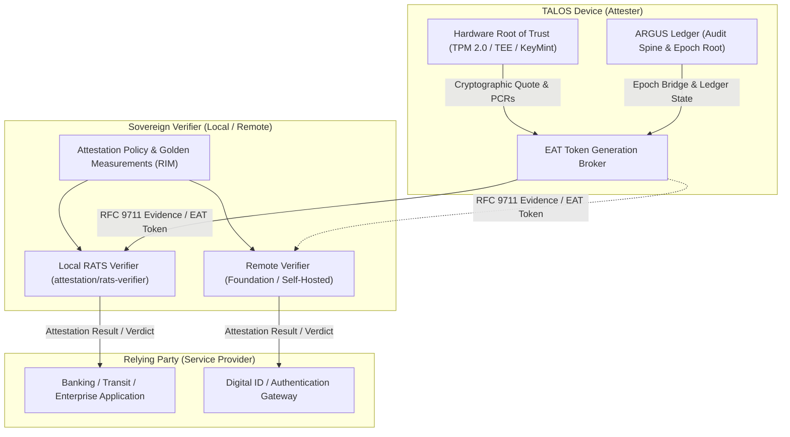
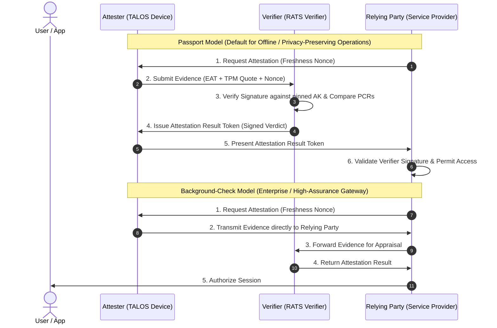
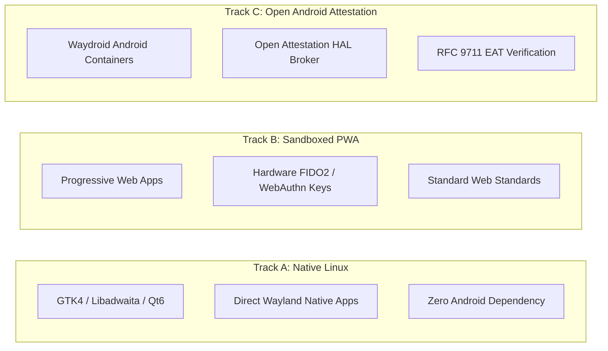

<!--
SPDX-FileCopyrightText: 2026 TALOS / LibreMobile OS Contributors
SPDX-License-Identifier: CC-BY-4.0
-->

# Sovereign Open Attestation Architecture (RATS & EAT)

> **Document Status:** Active Architectural Specification  
> **Standard References:** IETF RFC 9334 (RATS), IETF RFC 9711 (EAT), TCG TPM 2.0 Library Specification  
> **Target Subsystems:** `attestation/rats-verifier`, `mobile/waydroid`, `argus`  
> **Companion Document:** [mobile/waydroid/PIF_ROADMAP.md](file:///home/alpha/android/mobile/waydroid/PIF_ROADMAP.md)

---

## 1. Architectural Overview

Mobile security relies heavily on verifying that an operating environment has not been tampered with, backdoored, or rooted by an adversary. In the legacy proprietary mobile ecosystem, this mechanism is monopolized by Google's Play Integrity API (formerly SafetyNet) and Apple's DeviceCheck. Both architectures require continuous submission of telemetry to proprietary cloud servers, operate under closed evaluation heuristics, and arbitrarily revoke device categories.

TALOS / LibreMobile OS replaces this proprietary lock-in with an open, decentralized attestation architecture based entirely on open standards:
1. **IETF RFC 9334:** Remote ATtestation ProcedureS (RATS) architecture.
2. **IETF RFC 9711:** Entity Attestation Token (EAT) profile.
3. **TCG TPM 2.0 / KeyMint:** Hardware-rooted cryptographic measurements.



---

## 2. RATS Roles & Topological Models (RFC 9334)

The RATS framework establishes three foundational roles:

### 2.1 The Core Roles
* **Attester (The Device):** The mobile endpoint executing TALOS. Collects measurements from its hardware root of trust (TPM 2.0, Secure Enclave, or OpenTitan) and constructs signed **Evidence**.
* **Verifier (The Evaluator):** Evaluates Evidence against appraisal policies and Reference Integrity Measurements (RIM). Computes a verifiable **Attestation Result**.
* **Relying Party (The Consumer):** An application, enterprise gateway, or financial institution that requires assurance before granting access or issuing credentials.

### 2.2 Supported Topological Models

TALOS supports both standard RATS topologies:



1. **Passport Model (Privacy-First & Local):** The Attester obtains an Attestation Result from the Verifier (which can run entirely on-device via `attestation/rats-verifier`) and presents the resulting verifiable credential to the Relying Party. No device telemetry is ever shared with third-party servers.
2. **Background-Check Model:** When interacting with strict enterprise or financial backends, the Attester supplies raw EAT Evidence; the Relying Party consults an independent or self-hosted Verifier.

---

## 3. Evidence Format: Entity Attestation Token (RFC 9711)

Evidence is structured as an **Entity Attestation Token (EAT)** encapsulated in a CBOR Web Token (CWT) or JSON Web Token (JWT). Every token carries cryptographic proof bound to the hardware security module.

### 3.1 Claims Schema

| Claim Key | Name | Type | Description |
|:---|:---|:---|:---|
| `iss` | Issuer | String | DID or URI of the Attestation Authority / Local Verifier. |
| `sub` | Subject | String | Identifier for the attested device environment. |
| `iat` | Issued At | Integer | UTC UNIX timestamp of token issuance. |
| `eat_profile` | EAT Profile | String | Target profile URI, e.g. `https://talos.org/eat/v1`. |
| `ueid` | Universal Entity ID | Byte String / Hex | SHA-256 fingerprint of the hardware Endorsement Key (EK). |
| `hwmodel` | Hardware Model | String | Canonical hardware device identifier (e.g., `PinePhone-Pro-v1`). |
| `swname` | Software Name | String | Operating system release: `TALOS-LibreMobile/1.0`. |
| `dbgstat` | Debug Status | String | Hardware debug state (`disabled-permanently` or `enabled`). |
| `boot_count` | Boot Count | Integer | Monotonic hardware-protected boot cycle counter. |
| `nonce` | Freshness Nonce | Byte String / Hex | Anti-replay challenge supplied by the Relying Party. |
| `measres` | Measurement Results | Map | Table of measured PCR indices and corresponding SHA-256 digests. |
| `tpm_quote` | TPM Attestation Quote | Object | Complete `TPMS_ATTEST` structure and `TPMT_SIGNATURE` from AK. |

### 3.2 Canonical PCR Allocation Table

TALOS measures boot and system integrity into standard TPM 2.0 PCR banks:

```
PCR 00: Core UEFI / Coreboot / U-Boot firmware binaries
PCR 01: Host platform configuration & device tree blobs (DTB)
PCR 02: Linux kernel image and kernel command-line arguments
PCR 04: Initramfs and dm-verity root filesystem metadata
PCR 07: Secure Boot policy, public keys, and PK/KEK/db state
PCR 10: ARGUS ARGF/2 epoch commitment root hash
PCR 14: Waydroid Android container image hash and configuration
```

---

## 4. Verifier Design

### 4.1 Local Verifier (`attestation/rats-verifier`)
* **Deployment:** Integrated Python stdlib service running on `localhost` or via UNIX domain socket `/run/talos/rats-verifier.sock`.
* **Zero Dependency:** Operates with Python 3 stdlib alone (`hashlib`, `hmac`, `json`, `struct`). No network access or third-party servers required.
* **Operation:** Evaluates local TPM quotes against pinned Attestation Public Keys (AKs) stored in `/etc/talos/attestation/keys/`.
* **Verdict Generation:** Emits RFC 9334 standard Trustworthiness Vectors:
  - `hardware_integrity`: `SECURE_HARDWARE`
  - `instance_identity`: `TRUSTED`
  - `executables`: `APPROVED`
  - `configuration`: `APPROVED`

### 4.2 Remote Verifier (Independent / Self-Hosted)
* **Independence:** Completely free of Google Play services, Firebase, or Apple infrastructure.
* **Federation:** Can be operated by the TALOS Commons Foundation, enterprise IT departments, or sovereign municipal authorities.
* **Reference Integrity Measurements (RIM):** Synchronizes approved kernel, initramfs, and container digests directly from reproducible build attestations (`repro/attestation-<git-sha>.json`).

---

## 5. Application Developer Outreach & Migration Tracks

To eliminate the need for Google Play Integrity spoofing, TALOS establishes three developer engagement tracks:



1. **Track A (Native Linux Ecosystem):** Partner with civic tech, privacy-focused developers, and open source communities to deliver first-party Linux desktop/mobile interfaces using GTK4, Libadwaita, and Qt6.
2. **Track B (Progressive Web Apps with Hardware FIDO2):** Provide bank and fintech engineering teams with reference PWA designs leveraging WebAuthn and hardware security keys for transaction signing, bypassing app store gatekeepers entirely.
3. **Track C (Open Android Attestation Provider):** Provide a drop-in Android client library (`talos-rats-client.aar`) that replaces Google Play Integrity API calls with standard RFC 9334 queries over local IPC to `attestation/rats-verifier`.

---

## 6. Migration Schedule & Sunset of `pif.json`

The transition from the legacy Play Integrity Fix shim to Sovereign Open Attestation follows the timetable established in [PIF_ROADMAP.md](file:///home/alpha/android/mobile/waydroid/PIF_ROADMAP.md):

| Target Phase | Timeline | Milestone Deliverables |
|:---|:---|:---|
| **Phase 1** | **Q1 2027** | `pif.json` designated TRANSITIONAL. Warning banner on boot. `TALOS_PIF_DISABLE=1` opt-out. Local RATS verifier skeleton committed. |
| **Phase 2** | **Q2 2027** | Invert default: `TALOS_PIF_DISABLE=1` enabled by default in release builds. Developer outreach toolkit published. |
| **Phase 3** | **Q3 2027** | `pif.json` completely stripped from system image builds. RATS local verifier promoted to primary attestation provider. |
| **Phase 4** | **Q4 2027** | **December 31, 2027**: Final sunset and complete removal of all spoofing logic and legacy microG overrides. |

`TODO(operator): Provision hardware-backed Attestation Key (AK) certificates and configure enterprise remote verifier endpoints.`
