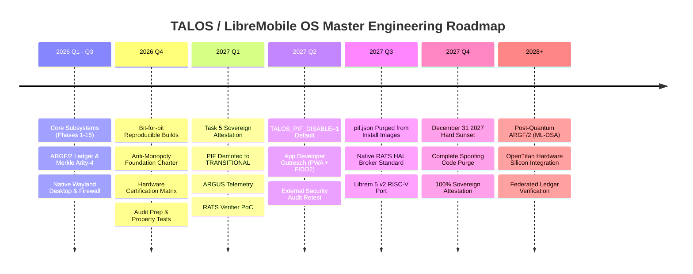

<!--
SPDX-FileCopyrightText: 2026 TALOS / LibreMobile OS Contributors
SPDX-License-Identifier: CC-BY-4.0
-->

# TALOS / LibreMobile OS Consolidated Project Roadmap

> **Document Status:** Authoritative Project Roadmap  
> **Target Horizon:** 2026 – 2028  
> **Governance:** Sovereign Commons Foundation ([CHARTER.md](file:///home/alpha/android/CHARTER.md) & [GOVERNANCE.md](file:///home/alpha/android/GOVERNANCE.md))  
> **Key Companion Roadmaps:** [mobile/waydroid/PIF_ROADMAP.md](file:///home/alpha/android/mobile/waydroid/PIF_ROADMAP.md), [ATTESTATION.md](file:///home/alpha/android/ATTESTATION.md), [HARDWARE.md](file:///home/alpha/android/HARDWARE.md)

---

## 1. Vision & Architectural Principles

TALOS / LibreMobile OS is an uncompromised, defense-grade mobile operating system and audit spine designed to provide sovereign, verifiable personal computing without surveillance capitalism, proprietary platform gatekeeping, or telemetry.

The project roadmap coordinates engineering across four sovereign pillars:
1. **Auditability & Integrity:** Tamper-evident, forward-secure forensic ledger (ARGUS ARGF/2) provable by third-party auditors.
2. **Reproducibility:** Bit-for-bit hermetic builds verifiable by any third party with machine-readable attestations.
3. **Hardware Transparency:** Honest, tiered hardware certification matrix free of false claims regarding proprietary blobs.
4. **Open Attestation:** Complete deprecation of proprietary integrity shims (Play Integrity / SafetyNet) in favor of IETF RATS (RFC 9334) and EAT (RFC 9711) standards.

---

## 2. Master Milestone Timeline

---

## 3. Subsystem Milestone Breakdown

### Phase 1: Core Sovereign Mobile OS & Daemons (Status: COMPLETED)
- **15 Verification Phases Operational:**
  - Cellular telephony daemon (`lrd-telephonyd`), ALSA audio manager (`lrd-audiod`), motion/ambient sensors (`lrd-sensord`), V4L2 camera HAL (`lrd-camerad`), GPS/NMEA geo-privacy daemon (`lrd-gpsd`).
  - S2Idle sleep power governor & 80% Li-ion charge guardian (`lrd-wakelockd`).
  - Layer-shell on-screen keyboard manager (`lrd-osk`) with exclusive zone viewport management.
  - Fingerprint biometrics PAM daemon (`lrd-biometricd`).
  - Binary translation bridge (`lrd-arm-bridge`) and container runtime.
  - BLE anti-tracking privacy shield and radio kill-switches (`lrd-bluetoothd`).
  - Wi-Fi MAC rotation and isolated hotspot gateway (`lrd-wifid`).
  - Strict defense-grade nftables mobile firewall with Tor DNS and emergency zero-egress panic lockdown (`lrd-firewalld`).
- **Acceptance Gate:** 100/100 automated mobile and trust verification tests passing (`make check`).

### Phase 2: Hermetic Reproducibility & Supply Chain Security (Status: COMPLETED)
- **Hermetic Build Environment:** `flake.nix` pinning exact compiler and system toolchain hashes; containerized Debian bookworm-slim fallback (`repro/Dockerfile`).
- **Deterministic Toolchain:** Enforced `SOURCE_DATE_EPOCH`, UTC normalization, GCC path prefix mapping (`-ffile-prefix-map`), deterministic tar sorting, and ext4 filesystem hash seeds.
- **Two-Pass Verification:** `scripts/repro-attest.sh` compiling into isolated paths `out/a` and `out/b`, validating byte-identical artifacts.
- **Machine Attestation:** Python stdlib validator `repro/verify-attestation.py` verifying `repro/attestation-<git-sha>.json`.

### Phase 3: Sovereign Commons Governance (Status: COMPLETED)
- **Constitutional Charter:** [CHARTER.md](file:///home/alpha/android/CHARTER.md) defining the non-profit foundation structure and democratic representation across 5 membership tiers.
- **Anti-Monopoly Governance:** [GOVERNANCE.md](file:///home/alpha/android/GOVERNANCE.md) establishing:
  - **No Single-Entity Veto:** Absolute prohibition against any individual, corporation, or sponsor holding blocking veto power.
  - **Surveillance-Free Funding Policy:** Explicit ban on adtech, data brokerage, and telemetry revenue.
  - **3-of-5 Multisig Releases:** Foundation key consensus required for release signatures.
- **Project Structure:** Subsystem owner directory [MAINTAINERS.md](file:///home/alpha/android/MAINTAINERS.md), Contributor Covenant 2.1 [CODE_OF_CONDUCT.md](file:///home/alpha/android/CODE_OF_CONDUCT.md), DCO contributor workflows [CONTRIBUTING.md](file:///home/alpha/android/CONTRIBUTING.md), and trademark fork defense [TRADEMARK.md](file:///home/alpha/android/TRADEMARK.md).
- **Compliance:** 100% REUSE-compliant SPDX attribution across all 349 files (`make reuse-lint`).

### Phase 4: Honest Hardware Certification (Status: COMPLETED)
- **Tiered Provenance Matrix:** [HARDWARE.md](file:///home/alpha/android/HARDWARE.md) eliminating overbroad claims:
  - **Tier A (Fully Free):** Zero proprietary firmware in active execution paths.
  - **Tier B (Blob-Reduced):** Documented, replaceable peripheral blobs.
  - **Tier C (Treble-Compatible):** Sovereign userspace on non-free vendor BSP blobs.
  - **Roadmap:** Future open hardware targets (Purism Librem 5 v2 RISC-V).
- **Validation Engine:** JSON Schema draft 2020-12 validator `scripts/hardware-matrix.py` ensuring idempotent markdown generation.

### Phase 5: Third-Party Audit Readiness & Property Testing (Status: COMPLETED)
- **Audit Foundation:** Comprehensive scope specification [audit/SCOPE.md](file:///home/alpha/android/audit/SCOPE.md) covering ARGF/2 Merkle arity-4, epoch bridges, duress plausible deniability, dead-man fail-safe wipe, and vault custody.
- **Formal Invariants:** Threat model [audit/THREAT-MODEL.md](file:///home/alpha/android/audit/THREAT-MODEL.md) detailing invariants `INV-M1` through `INV-H2`.
- **Property-Based Testing:** 18 Hypothesis property and static vector tests verifying arity-4 proof bounds, rollover crash survivability, duress plausibility scoring, and deadman grace-period bounds (`make audit-prep`).
- **Auditor RFP:** Public procurement document [audit/RFP.md](file:///home/alpha/android/audit/RFP.md) and tracking status dashboard [SECURITY-AUDIT.md](file:///home/alpha/android/SECURITY-AUDIT.md).

### Phase 6: Play Integrity Demotion & Sovereign Attestation (Status: ACTIVE / TASK 5)
- **Transitional Shim Demotion:**
  - `mobile/waydroid/pif.json` marked with explicit `_comment` deprecation notice.
  - `lrd-pif-apply` outputs warning notices to `stderr` and records ARGUS audit event `pif_applied_transitional=true`.
  - Immediate opt-out support via environment variable `TALOS_PIF_DISABLE=1`.
  - Deprecation roadmap with measurable exit gates in [mobile/waydroid/PIF_ROADMAP.md](file:///home/alpha/android/mobile/waydroid/PIF_ROADMAP.md).
- **Open RATS Architecture:**
  - Full architectural specification in [ATTESTATION.md](file:///home/alpha/android/ATTESTATION.md) implementing IETF RFC 9334 and RFC 9711 EAT tokens.
  - Pure Python stdlib reference verifier engine `attestation/rats-verifier` validating TPM 2.0 quotes against pinned Attestation Keys.
  - Committed static test vectors demonstrating AFFIRMED and CONTRAINDICATED verdicts (`make test-attestation`).
- **App Developer Outreach:**
  - Track A (Native Linux): Direct Wayland/GTK4/Qt6 application enablement.
  - Track B (Sandboxed PWA): Progressive Web Apps authenticated via FIDO2 / WebAuthn.
  - Track C (Open Android Attestation): Drop-in Android HAL broker translating Waydroid requests to local RATS verifier queries.
- **Hard Sunset Cutoff:** December 31, 2027 hard purge of all Play Integrity spoofing assets.

---

## 4. Forward Horizons (2027 – 2028+)

| Quarter | Subsystem | Horizon Deliverable | Governing Invariant |
|:---|:---|:---|:---|
| **2027 Q2** | **Attestation** | Invert `TALOS_PIF_DISABLE=1` to default; launch pilot with $\ge 3$ banking/fintech app providers. | `EC-01` |
| **2027 Q3** | **Hardware** | Initial developer BSP for Purism Librem 5 v2 (RISC-V mobile silicon) and OpenTitan root-of-trust. | `TIER-ROADMAP` |
| **2027 Q4** | **Attestation** | **December 31, 2027**: Final deletion of `pif.json` and microG spoofing from master tree. | `EC-05` |
| **2028 Q1** | **Forensics** | Post-Quantum Cryptography (PQC) epoch signing: ML-DSA / Dilithium signatures for ARGF/2 checkpoints. | `INV-E1` |
| **2028 Q2** | **Ecosystem** | Multi-device distributed ledger mesh: zero-knowledge proof synchronization of ARGUS alibis over Tor v3 onion services. | `INV-A1` |

`TODO(operator): Update community roadmap quarterly during Foundation General Assemblies.`
