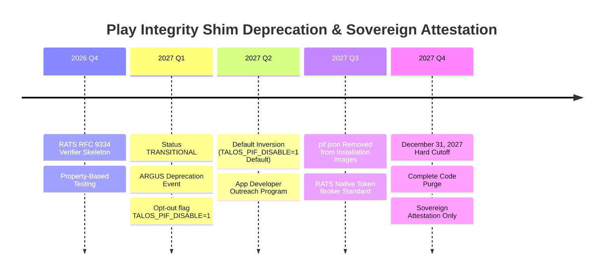

<!--
SPDX-FileCopyrightText: 2026 TALOS / LibreMobile OS Contributors
SPDX-License-Identifier: CC-BY-4.0
-->

# Play Integrity Transitional Shim & Sunset Roadmap

> **Status:** `TRANSITIONAL` (Deprecated)  
> **Document Revision:** 1.0.0  
> **Initial Deprecation:** Q1 2027  
> **Hard Sunset Cutoff:** December 31, 2027  
> **Governing Architecture:** Open RATS Architecture ([ATTESTATION.md](../../ATTESTATION.md))

---

## 1. Executive Summary

TALOS / LibreMobile OS ships an isolated Waydroid Android compatibility container to support essential Android applications. Historically, running proprietary mobile applications (particularly banking, transit, and enterprise utilities) on open Android containers required injecting certified Google hardware fingerprints (`pif.json`) via `lrd-pif-apply` to satisfy Google Play Integrity API verdicts (`MEETS_BASIC_INTEGRITY` and `MEETS_DEVICE_INTEGRITY`).

This document formally designates all Play Integrity Fix (PIF) profile injection and microG signature spoofing mechanisms as an **explicitly transitional shim**.

Spoofing proprietary device fingerprints is philosophically and technically incompatible with a sovereign, verifiable operating system. TALOS is actively transitioning to open, standards-based remote attestation via the IETF Remote Attestation Procedures (RATS, RFC 9334) architecture and Entity Attestation Tokens (EAT, RFC 9711).

---

## 2. Risk Analysis

Continuing to rely on Play Integrity spoofing poses severe technical, legal, and architectural liabilities to the TALOS project and its users.

### 2.1 Technical & Security Risks
1. **Asymmetric Cat-and-Mouse Game:** Google continually harvests and revokes leaked hardware secret keys and device fingerprints. Fingerprint revocation causes sudden, unpredictable application outages for end users without remediation paths.
2. **Inability to Satisfy Hardware Attestation:** Google Play Integrity is migrating towards mandatory hardware-backed KeyMint / TEE attestation (`MEETS_STRONG_INTEGRITY`). Pure userspace property spoofing cannot forge asymmetric hardware signatures issued by Google-provisioned TEE keys.
3. **Fragile System State:** Emulated system properties break ABI guarantees, degrade graphics acceleration paths, and complicate forensic ledger audits.
4. **False Security Posture:** Spoofing misleads both developers and users by asserting an untruthful security environment rather than demonstrating genuine, verified system integrity.

### 2.2 Legal & Governance Risks
1. **Terms of Service Exposure:** Exploiting unreleased or extracted Google factory image fingerprints directly conflicts with Google API and Play Console terms of service.
2. **Trademark Dilution & False Origin Claims:** Claiming an arbitrary Linux device is a `"Google Pixel 8 Pro"` exposes the distribution and downstreams to claims of trademark infringement or false designation of origin under consumer protection statutes.
3. **Anti-Circumvention (DMCA §1201 / EU Copyright Directive Article 6):** In jurisdictions with aggressive technological protection measure (TPM) laws, bypassing integrity verifiers could be characterized as unauthorized circumvention.
4. **Monopoly Entrenchment:** Submitting to Google's proprietary gatekeeper validates Google's monopoly over application distribution and device attestation.

---

## 3. Measurable Exit Criteria

The Play Integrity transitional shim (`pif.json` and `lrd-pif-apply`) will be systematically decommissioned upon meeting **any** of the following measurable gates, and unconditionally removed no later than the calendar cutoff:

| ID | Exit Criterion | Measurement Metric | Target Verification |
|:---|:---|:---|:---|
| **EC-01** | **Banking / Fintech Adoption** | $\ge 3$ major banking or fintech applications in Tier-1 jurisdictions accept open RATS attestation (RFC 9334) or publish fully functional Progressive Web Apps (PWAs) supporting FIDO2 / WebAuthn. | In-app transaction test suite & community verification. |
| **EC-02** | **Digital Identity & Public Services** | $\ge 5$ national or municipal digital ID / e-government services offer standards-based OIDC / W3C Verifiable Credentials without Play Services dependency. | Operator verification logs in `attestation/`. |
| **EC-03** | **Hardware Attestation Enforcement** | Google enforces mandatory asymmetric KeyMint hardware attestation on all Play Integrity tiers, rendering userspace fingerprint spoofing universally inert. | Upstream Google Play Integrity API specification change. |
| **EC-04** | **Native Ecosystem Readiness** | 100% of top 25 recommended sovereign utilities on TALOS have native Linux / Wayland packages or sandboxed Web wrappers. | Project app directory catalog. |
| **EC-05** | **Calendar Cutoff Date** | **December 31, 2027**: Irrespective of third-party app adoption, all `pif.json` assets and spoofing code are unconditionally deleted from the repository. | Git release tag `v2028.1.0`. |

`TODO(operator): Track and update specific regional banking app adoption in operator ledger.`

---

## 4. Phase-by-Phase Deprecation Timeline

### Phase 1: Explicit Deprecation & Telemetry (Q1 2027) — Current State
- `pif.json` carries a top-level `"_comment": "TRANSITIONAL — see PIF_ROADMAP.md"` metadata warning.
- `lrd-pif-apply` outputs warning notices to `stderr` on every boot and container invocation.
- Emits an append-only ARGUS audit ledger event: `pif_applied_transitional=true`.
- Supports immediate opt-out via environment variable `TALOS_PIF_DISABLE=1`.

### Phase 2: Inverted Default (Q2 2027)
- `TALOS_PIF_DISABLE=1` becomes the default build and runtime configuration for TALOS.
- Users wishing to run the transitional shim must explicitly execute `lrd-pif-apply --enable-transitional-shim`.
- App-developer outreach initiative begins, engaging developers of banking and security-sensitive apps to integrate the open TALOS RATS verifier.

### Phase 3: Image Stripping (Q3 2027)
- `pif.json` is stripped from official system releases and daily installation media.
- Native RATS attestation daemon (`attestation/rats-verifier`) is enabled as the default identity provider for containerized and native environments.

### Phase 4: Complete Sunset & Code Purge (Q4 2027 / December 31, 2027)
- Complete removal of `mobile/waydroid/lrd-pif-apply` and all microG signature spoofing code.
- Hard failure of any component attempting to synthesize Google hardware identities.
- Project achieves 100% sovereign, transparent attestation.
